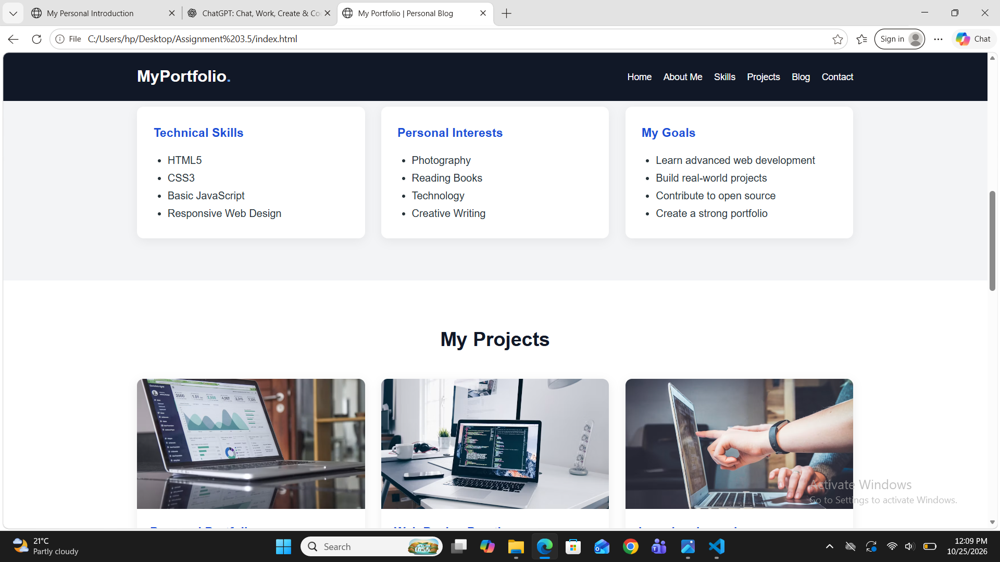
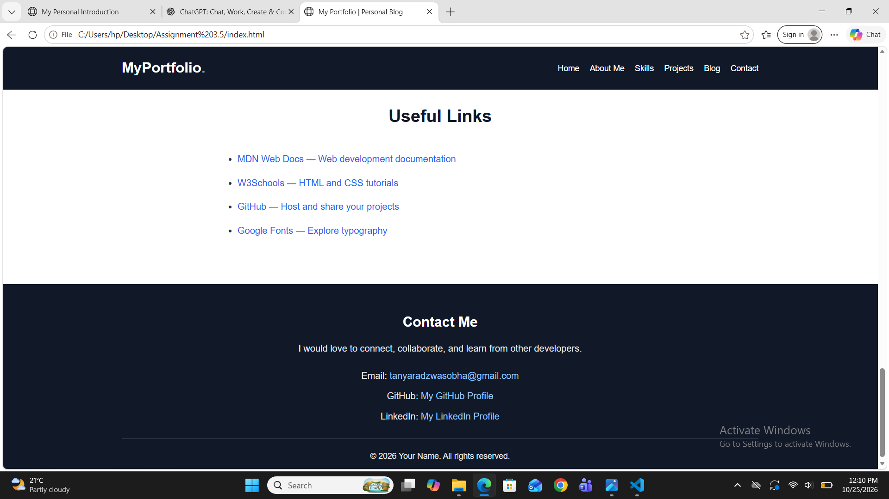

# Assignment 3.5 — Blog / Portfolio Mini-Project

## Theory

### 1. Introduction

A personal blog or portfolio website is a website used to share personal information, skills, interests, projects, and contact details. It helps students and professionals present their work and achievements online. This project is developed using HTML and CSS.

### 2. Objective

The main objective of this project is to learn how to create a personal portfolio website using HTML and CSS. It also helps in understanding semantic HTML tags, hyperlinks, images, lists, navigation bars, and webpage styling.

### 3. Technologies Used

- HTML5: Used to create the structure and content of the website.
- CSS3: Used to style the website, including colors, fonts, spacing, layout, and responsiveness.
- Web Browser: Used to open and view the website.
- GitHub: Used to store and share the project source code online.

### 4. Description of the Website Sections

1. Header: Displays the name or logo of the website and a welcome message.
2. Navigation Bar: Provides links to different sections of the website, such as Home, About Me, Skills, Projects, and Contact.
3. About Me: Contains personal information, educational background, and career goals.
4. Skills or Interests: Lists technical skills, hobbies, and areas of interest using HTML lists.
5. Blog Posts or Projects: Displays projects or articles with titles, descriptions, images, and links.
6. Images: Makes the website more attractive and helps visitors understand the content visually.
7. Useful Links: Provides links to educational websites, tutorials, and other useful resources.
8. Footer: Displays contact details, email address, GitHub profile, and copyright information.

### 5. HTML Semantic Tags

Semantic HTML tags describe the purpose of different parts of a webpage. In this project, the following tags are used:

- `<header>` — Defines the header section.
- `<nav>` — Defines the navigation links.
- `<main>` — Contains the main content.
- `<section>` — Groups related content.
- `<article>` — Represents an independent project or blog post.
- `<footer>` — Defines the footer section.
- `<ul>` and `<li>` — Create lists.
- `<a>` — Creates hyperlinks.
- `` — Displays images.

### 6. Role of CSS

CSS is used to improve the appearance of the website. It controls the background colors, font styles, text alignment, margins, padding, borders, and image sizes. Media queries can also be used to make the website responsive on mobile phones, tablets, and computers.

### 7. Working of Navigation Links

The navigation bar uses HTML anchor tags to connect to different sections of the same webpage. Each navigation link uses an `href` attribute containing a section ID. When a visitor clicks a link, the browser moves to the corresponding section.

### 8. Advantages

- Helps showcase personal skills and projects.
- Improves knowledge of HTML and CSS.
- Provides an online professional presence.
- Makes information easy to access.
- Develops basic web design and development skills.
- Allows projects to be shared through GitHub.

### 9. Conclusion

The Blog / Portfolio Mini-Project provides practical knowledge of HTML5 and CSS3. It demonstrates how to create a well-structured, attractive, and user-friendly website using semantic tags, images, lists, hyperlinks, and navigation links. This project builds a strong foundation for learning advanced web development.

OUTPUT

